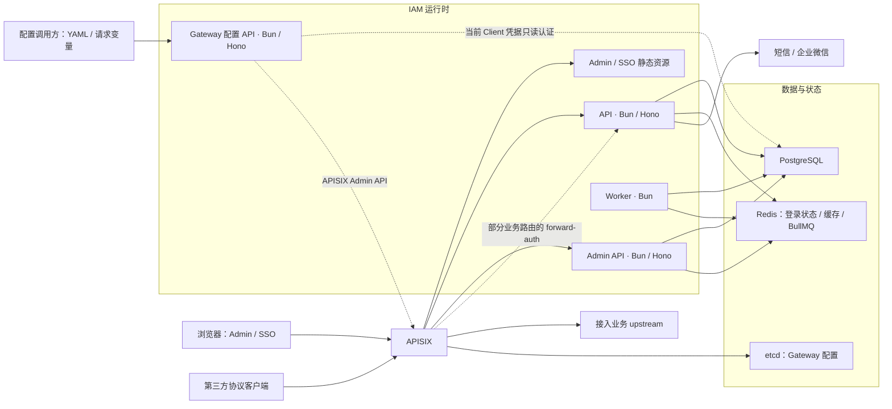

# 系统架构视图

本文面向维护者，说明请求流、信任边界、数据权威和恢复分工。代码位置见[仓库地图](repository-map.md)，
内部协作见[后端架构](backend-architecture.md)与[前端架构](frontend-architecture.md)。

## 逻辑拓扑

箭头表示逻辑依赖，不表示每次操作都会访问所有依赖。图中的分组也不表示物理共机、数据库读写分离或生产网络隔离。
共享 packages 在消费方进程内执行，不是独立网络服务。

### 请求入口与后台任务

路由和 rewrite 由[环境 manifest](../../tmp/gateway-config/apisix/manifests/prod/iam.yaml)声明：

| 入口                                                                             | 处理方              |
| -------------------------------------------------------------------------------- | ------------------- |
| `/portal`、`/iam-admin`                                                          | SSO、Admin 静态前端 |
| `/api/iam/public/*`、`/api/iam/open/*`、`/api/iam/internal/*`、`/api/iam/auth/*` | API                 |
| `/sso/*`、`/oidc` 及其子路径                                                     | API                 |
| `/api/iam/admin/*`、`/api/iam/rpc/*`                                             | Admin API           |

Gateway 去除 `/api/iam` 前缀后转发。IAM 自身路由不统一使用 forward-auth；接入业务是否使用它，以各自 manifest 为准。
经过 Gateway 不代表完成认证或授权。

Worker 消费队列并承担重建、修复和核验；其 HTTP 仅用于健康状态及可选 Bull Board。
Gateway 配置 API 是独立入口，首次发布可直连，通过固定 APISIX Admin API 目标发布配置；HTTP health 只表示服务就绪。

## 信任边界

- **浏览器与后端**：按钮和菜单只是服务端权限的呈现，每次请求仍由后端授权。HR 范围按请求时数据库事实决定，
  已获授权请求可能在并发撤权后完成，见[后端授权边界](backend-architecture.md#organization-responsibility-解析)。
  页面如何使用授权结果见[前端权限呈现](frontend-architecture.md#管理路由与权限)。
- **代理与服务**：host/path、真实 IP 和 header 的可信性依赖部署的代理、CIDR 和网络隔离，须按
  [Gateway 手册](../releases/apisix-gateway-release.md)核验，不能单凭转发头建立信任。
- **协议与业务**：协议入口负责解析、认证和错误映射，规范化上下文通过显式接口进入业务层。
- **配置调用方与 Gateway**：每请求用 scope 对应的当前 Client 凭据认证；调用方不能指定管理地址、Admin Key 或服务器路径。
  该匹配不提供域名配额、插件权限或完整多租户隔离，见[Gateway 接入](../guides/gateway.md)。
- **IAM 与第三方**：IAM 管理协议状态，第三方管理自己的本地会话；IAM 撤销不等于第三方退出。
  短信、企业微信等外部调用由 API 注入 adapter，网络作用不能随数据库事务回滚。

## 数据权威来源与恢复责任

| 数据或状态                           | 权威来源                                                         | 恢复责任                                         |
| ------------------------------------ | ---------------------------------------------------------------- | ------------------------------------------------ |
| 用户、任职、组织、角色、Client       | PostgreSQL 业务表                                                | 业务入口维护源事实                               |
| User Profile / Subject Facts         | PostgreSQL 发布结果与 dirty 版本                                 | 读模型与 Worker 重建发布；Facts reader 修复缓存  |
| Organization Search                  | PostgreSQL 源变化、dirty、文档与墓碑                             | 独立读模型与 Worker 恢复两阶段工作               |
| UserSession、ClientSession、登录限制 | Redis 实时状态                                                   | Kernel / LoginRestriction；丢失后不能从审计重建  |
| Subject Access                       | Redis 请求时屏障，恢复依据为 PostgreSQL 账号和 transition intent | 生命周期协调器与 Worker 对照当前 Facts 收敛      |
| Client Snapshot                      | PostgreSQL Client 配置                                           | Snapshot 模块维护缓存，Worker 执行修复与独立核验 |
| 重建队列                             | PostgreSQL 保存待处理事实                                        | 队列负责唤醒，repair 补偿丢失的唤醒              |
| 审计与运行日志                       | PostgreSQL 审计记录、Loki 应用日志                               | 各应用写入，Alloy 采集日志                       |
| Gateway 配置                         | 调用方保管源 YAML，APISIX/etcd 保存实际配置                      | Gateway 进程内补偿；未知或崩溃后人工恢复         |

读模型不能反向成为源业务事实。Redis 同时承载缓存和权威登录状态，恢复必须按 owner 区分：
Facts 可以重建，登录态不能重造，访问屏障缺失时拒绝访问；Snapshot 从备份恢复后须停流全量修复并独立核验。
恢复入口见[会话维护](../releases/authentication-and-session.md)和[数据维护](../releases/data-maintenance.md)。

## 一致性边界

| 场景               | 必须理解的边界                                                 | 详细规则                                                           |
| ------------------ | -------------------------------------------------------------- | ------------------------------------------------------------------ |
| 业务写入与后续传播 | 数据库提交后传播失败不代表回滚，不能自动重放写入               | [事务](backend-architecture.md#transactions-与-aftercommit)        |
| 账号访问           | 每个业务操作固定一次许可，新操作重新检查；重启用不恢复旧代     | [Subject Access](backend-architecture.md#subject-access-barrier)   |
| Client 配置        | 一次获取固定一份配置；传播成功影响后续获取，失败须显式修复     | [Snapshot](backend-architecture.md#client-snapshot)                |
| 资料与授权披露     | 使用已发布事实，可能滞后；实际交付按当前披露范围裁剪           | [主体投影](backend-architecture.md#client-subject-projection)      |
| 组织搜索           | 独立按组织发布，允许新建或删除延迟，不在每次查询核验覆盖率     | [组织发布](backend-architecture.md#organization-search-发布与核验) |
| 会话与协议         | 根期限固定，子关系受根约束；撤销针对精确实例                   | [会话](backend-architecture.md#session-runtime-与跨-app-边界)      |
| Gateway 发布       | 实例内串行、有界补偿，允许部分生效；无跨实例事务或崩溃自动恢复 | [Gateway](backend-architecture.md#网关配置发布)                    |

新增跨服务流程时明确事实归属、观察时点、失败前已生效作用和恢复负责人，再选择接口与验证方式。

## 部署与观测

生产 Compose 分为 data、apps、gateway 和 observability。数据、应用与 Gateway 使用相同 project，观测独立；
服务选择和现场检查见[部署手册](../releases/deployment.md)。本地验证不替代目标环境的停流、排空、恢复和放流。
旧来源升级须使用匹配版本的流程，入口见[历史工具](../development/commands.md#历史数据维护工具)。

应用日志经 Alloy 写入 Loki，Grafana 提供查询。APISIX OTLP 当前使用 debug exporter，尚不能作为持久化 trace backend。
采集与排障见[日志手册](../releases/observability-system-logs.md)，字段和脱敏见
[Logging](../development/backend-implementation.md#logging)。
