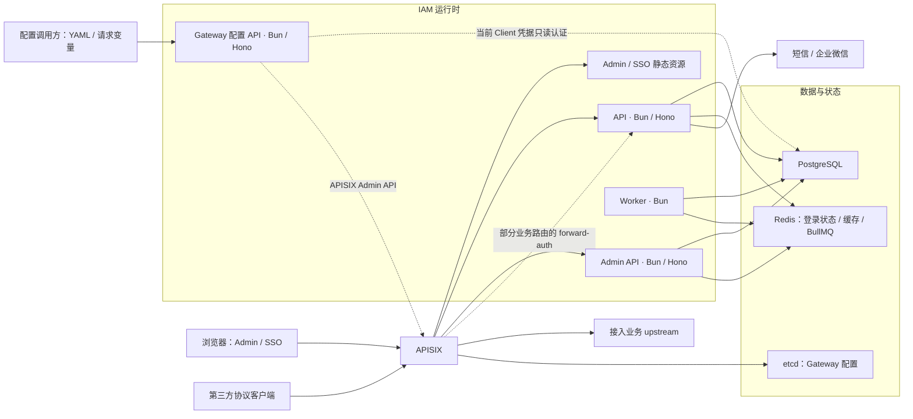

# 系统架构视图

本文说明 IAM 的请求如何流转、各运行时负责什么、数据以哪里为准，以及故障后由谁恢复。
跨 runtime 设计、改变数据流或准备发布时，可以从这里了解全局，再沿链接阅读具体契约。

| 要了解的问题                             | 阅读位置                                          |
| ---------------------------------------- | ------------------------------------------------- |
| 请求经过哪些服务，入口由谁处理           | [逻辑拓扑](#逻辑拓扑)                             |
| 哪一层负责认证、授权和外部调用           | [信任与协议边界](#信任与协议边界)                 |
| 哪些是源数据，哪些能重建，故障后如何恢复 | [数据权威来源与恢复责任](#数据权威来源与恢复责任) |
| 一次请求使用哪个时点的状态，变更何时生效 | [一致性边界](#一致性边界)                         |
| 部署配置和本地验证能证明什么             | [部署与观测边界](#部署与观测边界)                 |

目录选址见[仓库地图](repository-map.md)，关键约束的验证入口见[架构验证归属](architecture-verification.md)。
模块内部规则由所链接的架构文档和 ADR 维护；本文不替代发布手册，也不代表生产环境已完成部署验收。

## 逻辑拓扑

箭头表示逻辑依赖，不表示每次操作都会访问所有依赖。图中的分组也不表示物理共机、数据库读写分离或生产网络隔离。
共享 packages 在消费方进程内执行，不是独立网络服务。

### 请求入口与后台任务

主要 HTTP 入口由 [IAM manifests](../../tmp/gateway-config/apisix/manifests/prod/iam.yaml) 声明：

| 外部路径                                                                         | 处理方              | 路由说明                                                                             |
| -------------------------------------------------------------------------------- | ------------------- | ------------------------------------------------------------------------------------ |
| `/portal`、`/iam-admin` 及其子路径                                               | SSO、Admin 静态前端 | 页面通过各 app 内的 service 发起业务请求。                                           |
| `/api/iam/public/*`、`/api/iam/open/*`、`/api/iam/internal/*`、`/api/iam/auth/*` | API                 | Gateway 去除 `/api/iam` 前缀；协议解析和鉴权由具体入口处理。                         |
| `/sso/*`                                                                         | API                 | 协议解析和鉴权由具体入口处理。                                                       |
| `/api/iam/admin/*`、`/api/iam/rpc/*`                                             | Admin API           | Gateway 去除 `/api/iam` 前缀；REST 与 tRPC 复用管理能力。                            |
| `/oidc` 及其子路径                                                               | API                 | `@iam/oidc` 负责完整协议操作；API HTTP adapter 负责 Cookie、错误、重定向和生命周期。 |

Worker 负责队列消费、health/readiness、可选 Bull Board 和一次性修复任务（one-shot repair）。
它的 HTTP 入口不提供业务 API；命令和 consumer 的资源生命周期由 Worker composition 管理。

Gateway 配置 API 独立监听 30004，Compose 默认向宿主 loopback 映射，首次发布可直连而不依赖 IAM 数据面路由。
它提供 validate/diff/apply，通过 IAM PostgreSQL 当前 Client 的 Internal Secret 与 scope 匹配认证，不依赖 Redis。
`GET /health` 只证明 HTTP 就绪；服务启动不证明数据库认证或 APISIX 可用。

**经过 Gateway 不代表已经完成认证或授权。** IAM 自身路由并不统一使用 `forward-auth`。
[Tender manifests](../../tmp/gateway-config/apisix/manifests/prod/tender.yaml) 中的部分业务路径调用 IAM authz；
[GDS manifests](../../tmp/gateway-config/apisix/manifests/prod/gds.yaml) 有自己的 authz endpoint 和适用路径。
新增接入时，必须确认具体路由由谁负责认证。

## 信任与协议边界

### 浏览器 → 后端：服务端决定权限

浏览器输入、菜单和按钮状态不构成授权事实。Admin capability 与 `allowedActions` 反映服务端的决定，
每次请求仍须由 Admin API 授权。详见[前端契约](frontend-architecture.md#管理路由与权限)和
[ADR-0017](../adr/0017-centralize-admin-role-policy-with-request-time-scope.md)。

### 代理 → IAM / 接入业务：代理信任需要部署验收

Gateway 负责 host/path rewrite、真实 IP 信任配置，以及按路由设置 header。
可信代理 CIDR、入口网络和实际端口可达范围需要在部署时验收；仓库中的拓扑图不能证明 header 来源可信，
也不能证明后端无法被直连。详见 [Gateway 发布手册](../releases/apisix-gateway-release.md)。

### 协议入口 → 业务模块：通过显式接口传递上下文

API、Admin API 分别负责各自的协议解析、认证和错误映射。
规范化后的 actor 与请求上下文通过显式接口流入业务层，详见[后端架构](backend-architecture.md#请求审计与可观测上下文)。

### 配置调用方 → Gateway API → APISIX：凭据与管理目标分开

调用方以 apikey 提交 scope 对应 Client 的 Internal Secret，不能指定 APISIX 地址、Admin Key 或服务器文件路径。
Gateway 每次只读查询当前 Client，要求 Enable、未删除且 Secret 匹配；首次 iam 发布必须预备 iam Client，
iam-admin 不自动替代。部署配置固定 APISIX 管理目标与 Admin Key，并提供数据库专用最小读取角色。
该身份匹配不建立域名/路径配额、插件权限或完整多租户隔离，详见
[网关接入](../guides/gateway.md)。

### IAM → 第三方：各自管理协议和本地会话

Custom SSO 与 OIDC 共享主体投影能力，各自负责协议报文（wire）和协议产物（artifact）的生命周期。
Independent client 自建的本地会话由第三方负责，IAM 撤销不等于第三方本地退出。
详见[第三方 SSO 对接](../guides/custom-sso.md)和 [OIDC 对接](../guides/oidc.md)。

短信和企业微信由 API composition 注入外部 adapter，分别用于验证码与微信登录；失败语义以各调用方契约为准。
新增外部调用时，按[事务与 afterCommit 规则](backend-architecture.md#transactions-与-aftercommit)选择执行位置：
网络调用不能随 PostgreSQL transaction 一起回滚。

## 数据权威来源与恢复责任

### 数据以哪里为准

| 数据或状态                                                | 权威来源                                                       | 负责方                                                                                               |
| --------------------------------------------------------- | -------------------------------------------------------------- | ---------------------------------------------------------------------------------------------------- |
| 用户、任职、组织、角色、Client 配置等业务事实             | PostgreSQL                                                     | 业务写入口负责变更；`@iam/db` 负责 schema 与持久化基础能力。                                         |
| User Profile / Subject Facts                              | PostgreSQL 中的 Profile 与 Dirty Version，记录发布及新鲜度状态 | `@iam/user-profile-read-model` 从源事实构建；Worker 负责重建与发布。                                 |
| Organization Search                                       | PostgreSQL 保存源变化、dirty、文档与删除墓碑                   | `@iam/organization-search-read-model` 从组织及闭包构建；队列只负责唤醒。                             |
| UserSession / ClientSession / Temporary Login Restriction | Redis 实时状态                                                 | Session Kernel / LoginRestriction。                                                                  |
| Subject Access Barrier                                    | Redis 中的请求时访问屏障                                       | Lifecycle coordinator 与 Worker recovery 对照 PostgreSQL 账号、transition intent 和当前 Facts 收敛。 |
| Client Runtime Snapshot                                   | PostgreSQL 中的 Client 配置                                    | 共享 Snapshot Module 负责 Redis control、统一安全 payload 与独立敏感 Credential payload。            |
| BullMQ rebuild 工作                                       | PostgreSQL Dirty 状态保存待处理事实                            | Queue 负责唤醒和处理，repair 负责恢复提交后的入队失败。                                              |
| Audit 与运行日志                                          | PostgreSQL `audit_log` 记录业务审计；Loki 保存采集的应用日志   | 应用日志经 Alloy → Loki，由 Grafana 查询。                                                           |
| Gateway Application Configuration                         | 调用方保管源 YAML，APISIX/etcd 保存实际配置                    | Gateway 只在当前请求内暂存前态并发布/补偿；不持有期望配置库、历史结果或持久恢复任务。                |

读模型和队列不能反向成为源业务事实，日志也不能替代当前授权或业务事实。
共享包选址与 DTO 演进见[共享契约](contracts-and-database.md)；敏感字段和作用已生效后的审计失败处理见
[审计契约](../development/backend-implementation.md#审计安全边界)。

Organization Search 按组织异步发布，独立维护 schema、补偿与一致只读全量核验。
首次、升级及全量恢复的人工窗口见[组织搜索维护](../releases/data-maintenance.md#组织搜索全量重建)。

### 哪些状态可以重建

Redis 中同时存在可重建缓存和实时权威状态，故障后必须按状态选择恢复路径：

- **Subject Facts 缓存**：可以重建。Worker 负责重建与发布，Reader 负责窄行 read-through，
  见[发布契约](backend-architecture.md#user-profile-subject-facts-publication)。
- **实时登录状态**：不能从 PostgreSQL 审计重建登录状态或历史会话清单，
  丢失状态的后果见 [ADR-0005](../adr/0005-keep-live-login-state-in-redis.md)。
- **Subject Access Barrier**：缺失或不确定时失败关闭，不能按普通缓存 miss 默认启用。
  恢复入口与调度责任见 [Barrier 契约](backend-architecture.md#subject-access-barrier)。
- **Client Runtime Snapshot**：可以重建，但不是普通 TTL 缓存。Worker 负责定向修复（targeted repair）和
  停流后的全量修复与核验（full repair/verify），见 [ADR-0021](../adr/0021-bind-protocol-runtime-cache-consistency-to-snapshot-acquisition.md)。
- **BullMQ rebuild 工作**：入队成功只表示工作已派发，不证明发布完成。提交后的入队失败由 repair 恢复，
  见[失效契约](backend-architecture.md#user-profile-失效)。
- **Gateway 发布前态与阻断**：只保存在当前进程内。恢复失败、未知或崩溃后，由发布负责人确认在途与迟到调用结束，
  核对并修复 APISIX，再重启服务；重启不核验恢复，也不重放旧请求，见[Gateway 发布手册](../releases/apisix-gateway-release.md)。

### Redis 备份恢复后的 Snapshot 处理

**恢复 Redis 备份后，Client Runtime 必须在停流状态下执行 full repair 和独立 verify。**
不能依赖 TTL 到期或逐 Client 访问来完成恢复。

当前 full repair/verify 只处理当前 Snapshot namespace，不清理或验证旧 Runtime key。
旧部署、旧备份的升级迁移必须另行安排，不能混跑旧 reader/writer。
完整步骤见[统一维护手册的 Snapshot 恢复流程](../releases/authentication-and-session.md#client-snapshot-修复)；
首次切换的历史边界见[历史 hard-cutover 手册](https://github.com/cyy1998/shgas-iam/blob/73315e4cef6f96dd79b29e18f74d68af30e559ec/docs/releases/client-runtime-snapshot-hard-cutover.md)。

## 一致性边界

不同状态的观察时点不同。阅读以下规则时，重点区分：当前调用已经固定了什么，以及后续调用会重新检查什么。

### Gateway 配置：实例内串行与有界补偿

每次请求重新读取 Client 认证事实，已认证的在途操作不因后续轮换、启停或删除中止。
apply 从 fresh read 到发布或恢复结束持有本实例执行权；首错停止正向写入并补偿已尝试目标，允许短暂部分生效。
补偿失败或未知后阻断本实例发布；调用方断连后原操作继续，发布和补偿均不自动重试。
服务不协调多个实例或外部写者，回滚保证以发布窗口没有这些并发写入为前提，不提供跨资源事务或崩溃自动恢复。
正常关闭等待在途操作，部署须为有界关闭保留余量；未知结果的人工恢复顺序由发布手册维护。

### 会话与协议状态

Kernel 只管理 UserSession 和 ClientSession；Custom SSO 与 OIDC 各自管理 Code、Token、续接及协议状态。

- UserSession 使用固定期限。
- ClientSession 的应用关系固定根会话与 Client。`open` 可复用有效实例、更新协议标记并单调延长期限，
  但期限不能超过原根会话。
- 访问时验证自身、根会话、应用关系，以及当前 Client / Subject Access。
  阻止已终止关系的访问，不依赖异步枚举和清理 Token。

旧布局的离线维护已退役，不进入线上探测。

### 账号访问：每次调用取得一次许可

API、Admin、Custom SSO 与 OIDC 在每个受影响接口首次解析出可信主体后，取得一次访问许可。
本次调用的成功、拒绝或暂态失败结果随之固定：已获许可的在途调用不复查账号状态，下一次调用重新检查。
Kernel 只管理对象生命周期，Projection 复用该许可。

重新启用账号不会恢复旧代。恢复步骤见 [Profile 与 Subject Access 维护](../releases/data-maintenance.md)。

### 数据库写入与发布：提交后失败不代表回滚

影响 Profile 的变更分三个阶段生效：

1. 源事实变更（mutation）与失效标记（invalidation）在同一源 transaction 内提交。
2. 发布（publication）原子提交 Profile 与 Dirty processed 状态。
3. 随后向 Redis 单调发布。

`required` after-commit 失败时，数据库仍可能已经提交。**不能仅因收到错误就自动重放业务写入。**

### Client 配置：一次 Snapshot 获取固定一份配置

一次获取（acquisition）共同固定 Client 状态与单协议配置。请求成功接受 Snapshot 后，可以继续使用这份 Snapshot；
Admin 变更传播成功，影响的是后续获取。

传播失败时，后续请求可能继续取得旧 Snapshot，需要显式 repair。这套传播机制不等于协议配置版本或 Session 撤销，
详见 [ADR-0021](../adr/0021-bind-protocol-runtime-cache-consistency-to-snapshot-acquisition.md)。

启停、配置和 Secret 维护不自动撤销会话；显式撤销只作用于捕获的精确实例。

### 主体事实与授权：消费已发布事实

普通 Profile 与 `iam:authorization` 都消费取得的已发布事实：

- 缓存有效命中时，不查 PostgreSQL。
- 缓存缺失或无效时，读取已发布 Profile，不检查 Dirty 新鲜度。

因此，旧角色事实可能持续交付；账号访问保护仍独立生效。
Custom SSO 与 OIDC UserInfo 在实际交付时，按当前披露范围构建投影；Code 只保留原授权事实，已签发的 ID Token 内容固定。
详见[投影契约](backend-architecture.md#client-subject-projection)。

### Admin 范围：按请求时的事实授权

服务端按请求时的 PostgreSQL 事实授权。已通过检查的请求，可能在并发撤权后完成；该模型不保证提交时线性化撤权。
适用范围与重新决策条件见 [ADR-0017](../adr/0017-centralize-admin-role-policy-with-request-time-scope.md)。

### 组织搜索：按组织异步发布

Organization Search 的源 mutation 与变化事件同事务提交，提交后按当前闭包可靠展开，再以 dirty 版本和 ownership
仲裁逐组织发布。在线查询只消费当前 schema 的已发布文档，允许合法旧事实、新建暂不可见及删除延迟退出；
完整放流门禁由维护窗口显式执行，不与 User Profile 发布绑定，也不成为每次查询的覆盖率检查。

新增跨 runtime workflow 时，先明确四件事：事实由谁负责、在哪个时点观察、失败前哪些作用已生效、失败后由谁恢复，
再选择公开接口与验证层。改变已有边界时，同步更新其权威契约或 ADR，以及[验证归属](architecture-verification.md)。

## 部署与观测边界

### 部署配置与现场验收

生产 Compose 分别声明[PostgreSQL 与 Redis](../../docker/compose.prod.data.yaml)、
[自研应用](../../docker/compose.prod.apps.yaml)、[APISIX 与 etcd](../../docker/compose.prod.gateway.yaml)
和[观测服务](../../docker/compose.prod.observability.yaml)。自研应用包含 API、Admin API、前端、各 Worker 与 Gateway 配置 API。
数据、应用和 Gateway 编排保留相同的 `iam-service-prod` project；观测使用独立 project。
部署入口、按主机选服务及停止清理约定见 [部署与发布](../releases/deployment.md)。
这些文件是部署输入，不能单独证明生产 profile、网络、TLS、备份恢复或外部依赖已经验收。

发布负责人在真实环境核验 readiness、停流、旧实例 drain、恢复和放流状态。
本地测试与拓扑图不能代替现场验收；代码交付也不表示目标环境已经切换。

### 日志与 Trace

[Alloy 配置](../../docker/observability/alloy/iam-logs.prod.alloy)采集带相应标签的 Docker 日志并写入 Loki。
APISIX OTLP span 进入 Alloy 后使用 debug exporter，因此不能据此宣称已有持久化 trace backend。
采集标签、保留与关联检查见[日志与排障](../releases/observability-system-logs.md)，应用字段与脱敏见[Logging](../development/backend-implementation.md#logging)。

### 当前模型与历史迁移

Spec #178 的最终在线图由 API、Admin API、Worker 和前端共同消费一代模型。
旧 OIDC app、Kernel 四对象、双协议列、Claims Snapshot 和三类旧 Snapshot/Gate 已退出生产；
旧候选的历史测试不能代替当前候选执行。

当前维护使用[会话与 Snapshot 手册](../releases/authentication-and-session.md)和
[Profile 恢复手册](../releases/data-maintenance.md)。
旧来源的数据库和状态迁移，需要从[历史工具入口](../development/commands.md#历史数据维护工具)恢复匹配版本的流程，
不能套用当前维护步骤。人工发布责任仍由发布负责人承担。
